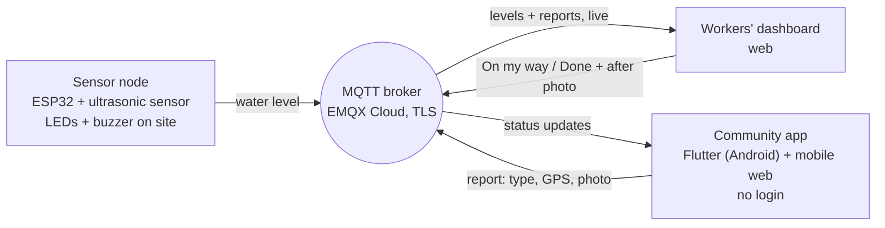

# Smart Drainage Guard

**See the risk. Act before the flood.**

**1st Place, Postgraduate category: SDSN Youth SA Innovation Challenge 2026** (Final Pitch Day, University of Pretoria, 22 October 2026)

Smart Drainage Guard is an IoT flood-warning system for municipal stormwater drains. Low-cost sensors watch the riskiest drains. Residents report every other drain with a phone, and no sign-up is needed. Municipal workers see everything live on one dashboard, respond, and prove each fix with a photo.

Live community app: https://voluble-jelly-df6fa8.netlify.app/community.html

---

## The problem

Drains block with waste, silt and illegal dumping. Municipal teams can only inspect them periodically, so the first report usually arrives after the street has flooded. Every response becomes an emergency.

## How it works



1. **Sense:** an ultrasonic sensor above the drain measures the water level. At 70% a warning LED lights, and at 85% a buzzer sounds on site, even with no signal.
2. **Report:** residents report a blocked, overflowing or damaged drain with GPS and a photo. Reports wait on the phone when there is no signal and send automatically later.
3. **Act:** workers see sensor levels and community reports together. They tap **On my way**, clear the drain, then **Mark as done** with a note and an after photo. The resident who reported it sees the status change live.

## Features

| Community app | Workers' dashboard | Sensor node |
|---|---|---|
| No account or phone number needed | Live water level for every sensor drain | Ultrasonic water-level reading |
| GPS location, photo and notes | All community reports with photo and map directions | Local LED and buzzer alarm |
| Offline queue, sends when signal returns | "On my way" so two crews don't go to the same drain | Non-blocking Wi-Fi and MQTT reconnect |
| Follow your report: Reported → Worker on the way → Fixed | "Mark as done" with note and after-photo proof | Publishes level and status over TLS |
| Share a report on WhatsApp | Demo mode that works offline | |

## Tech stack

- **Mobile:** Flutter (Dart): `mqtt_client`, `geolocator`, `image_picker`, `url_launcher`, `shared_preferences`
- **Web:** HTML, CSS, JavaScript, MQTT.js over secure WebSockets, hosted on Netlify
- **Messaging:** MQTT on EMQX Cloud Serverless, with TLS (port 8883 for devices and apps, WSS 8084 for browsers)
- **Hardware:** ESP32 / ESP8266, ultrasonic sensor, LEDs and buzzer, Arduino IDE
- **Testing tools:** Python drain simulator (`paho-mqtt`)

## MQTT topics

All messages are JSON. Report and status messages are retained, so a phone that opens later still sees the latest state.

| Topic | Written by | Contents |
|---|---|---|
| `sdg/drain/{id}/level` | Sensor node | Water level, percentage, timestamp |
| `sdg/drain/{id}/status` | Sensor node | Online or offline |
| `sdg/report/{id}` | Community app | Type, location, photo, notes |
| `sdg/status/{id}` | Workers' dashboard only | `progress` or `cleared`, worker, note, after photo |

## Security and privacy

- Every role has its own broker login: community, workers, dashboard and each sensor node.
- Broker permissions: the community login may publish only to `sdg/report/#`, so only workers can change a job's status.
- All traffic is encrypted with TLS.
- Residents give no account or phone number, and a name is optional. The system monitors drains, not people.
- Worker and device passwords are never stored in this repository. The dashboard asks for its password at sign-in.

## Repository structure

```
lib/                  Flutter community app
  config.example.dart Template for broker settings (copy to config.dart)
  models/             Report model
  screens/            Report, My reports, About
  services/           MQTT connection, offline queue, location
android/              Android project files
website/
  index.html          Home page
  community.html      Community app for phone browsers
  dashboard.html      Workers' dashboard
hardware/             ESP32 / ESP8266 sensor sketch
tools/
  simulate_drains.py  Publishes realistic test readings for demos
docs/screenshots/     Screenshots used in this README
```

## Getting started

### Community app (Flutter)

```bash
cp lib/config.example.dart lib/config.dart   # then fill in your broker details
flutter pub get
flutter run                                  # or: flutter build apk --release --split-per-abi
```

### Website

Open `website/index.html` locally, or deploy the `website` folder to any static host (this project uses Netlify).

### Drain simulator

```bash
pip install paho-mqtt
python tools/simulate_drains.py --host <broker-host> --user <user> --password <password>
```

## Roadmap

- 12-month pilot with 10 LoRaWAN sensor nodes at Mangaung drains
- Push notifications when the app is closed
- History database for response times, blockage hotspots and reports
- Sesotho, Setswana, isiXhosa and Afrikaans
- Merge duplicate reports and add a "Still blocked" button for residents
- Predict risky drains from rain forecasts and each drain's history

## SDG alignment

Led by **SDG 11** (Sustainable cities and communities, target 11.5), with support for SDG 13 (Climate action), SDG 9 (Resilient infrastructure), SDG 6 (Clean water) and SDG 3 (Health).

## Team A065, Central University of Technology, Free State

- Lungile Saliwe: IT & Technical Lead (community app, workers' dashboard, cloud messaging)
- Kamogelo Motshumi
- Thapelo Mahloko
- Reitumetse
